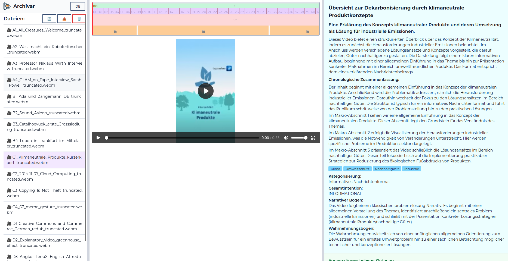

🇩🇪 Deutsch | [🇬🇧 English](README_en.md)

# KI-Video-Analyse-Tool: Archivar

> [!IMPORTANT]
> Die Standardkonfiguration **S** wird nicht für den Produktiveinsatz empfohlen, sondern dient primär dem Test der technischen Funktionalität des Systems im Rahmen von E2E-Tests. Die beste Ergebnisqualität wird mit der Konfiguration **L** erzielt; die Konfiguration **M** stellt einen sinnvollen Kompromiss zwischen Qualität und Geschwindigkeit dar. Details finden sich in den Evaluationsergebnissen im Abschlussbericht.

> [!WARNING]
> Erwarten Sie bitte keinen produktionsreifen Programmcode. Dies ist ein Forschungsprototyp, der die Fähigkeiten von LLMs und multimodalen KI-Systemen im Kontext von Medienarchivierung demonstriert. Nutzung auf eigene Gefahr. 

> [!WARNING]
> **KI-Kennzeichnung:** Alle Analyse-Ergebnisse des Archivar-Systems sind vollständig KI-generiert. Die KI kann Fehler machen. Bitte prüfen Sie wichtige Informationen.

Das KI-Video-Analyse-Tool Archivar ist eine technisch vollständige Lösung für die KI-gestützte Video- und Audioanalyse. Es besteht aus einer Hauptanwendung (`archivar-poc`) plus eigenständigen, containerisierten Inferenzservern (vLLM, OpenAI-kompatible APIs). Inferenzserver liegen in den T-Shirt-Size-Konfigurationen S, M und L vor und sind funktionsfähig - müssen jedoch für die individuelle Hardware konfiguriert werden. Alle Teile des Systems greifen auf ein gemeinsame Medienverzeichnis (`sample_data`) zu.



## Erste Schritte

* Docker mit NVIDIA Container Toolkit installieren.
* `uv` installieren: https://docs.astral.sh/uv/getting-started/installation/
* Repository klonen.

Dann genügen vier Befehle im Wurzelverzeichnis:

```bash
make setup    # 1. installiert alles: Container-Images, Modellgewichte,
              #    Abhängigkeiten und die Demo-Testdaten in sample_data/test
make start    # 2. startet die S-Konfiguration zu Testzwecken 
              #    (**nicht für den Produktiveinsatz empfohlen**): 
              #    Qwen3-ASR-0.6B (:8932),
              #    Gemma4-E4B (:9031), segment-scenes, sample-data-serve
              #    und die Hauptanwendung (Container) auf http://localhost:8802
make test     # 3. testet die S-Konfiguration technisch vollständig:
              #    Unit-/Integrationstests + Live-E2E-Tests von archivar-poc
make open     # 4. öffnet die Weboberfläche von archivar im Browser (:8802)
```

Weitere nützliche Ziele: `make status` (Zustand aller Dienste), `make stop`, und `make download-public-dataset` (lädt den CC-lizenzierten öffentlichen Eval-Datensatz nach `sample_data/archivar` und vorverarbeitet ihn-nur zum erneuten Durchlaufen der Evaluation nötig).

Die Konfigurationen **M** und **L** werden bewusst nicht über das Root-Makefile gestartet-sie benötigen deutlich mehr VRAM (siehe Tabelle) und werden aus ihren jeweiligen Projektverzeichnissen heraus gestartet (`make setup && make start`). Details stehen in den READMEs der einzelnen Projekte.

## Konfigurationen

> [!IMPORTANT]
> KI-Inferenz-Server erfordern das vorhandensein seiner vom Inferenz-Server für das gewählte KI-Modell unterstützen Grafikkarte (GPU) mit ausreichender Menge Speicher (VRAM). Der Inferenz-Server muss außerdem so eingestellt werden (Konfiguration), dass er einerseits die richtige GPU verwendet, wenn mehrere vorhanden sind und andererseits auch die optimale Variante für Attention und KV-Cache. Die vorliegende S-Konfiguration is auf NVIDIA-Systeme ausgelegt und wurde mit NVIDIA H200 NVL sowie RTX 3090 GPUs getestet. Die M und L-Konfigurationen wurden ausschließlich auf NVIDIA H200 NVL GPUs getestet. Bitte entnehmen Sie die notwendigen Konfigurationsparameter, die für Ihre GPU-Hardware gelten, der Inferenz-Server-Dokumentation (z.B. vLLM-Projekt).

Die Hauptanwendung (`archivar-poc`) definiert drei Workflow-Konfigurationen; jede kombiniert ein VLM für die Video-/Bildanalyse mit einem ASR-Server für die Transkription:

| Konfiguration | Workflow | Typ | KI-Modell | Port | Gemessene VRAM-Spitze |
|---|---|---|---|---|---|
| **S** | `default-analysis-gemma4-e4b` | VLM | gemma-4-E4B-it-qat-w4a16-ct | 9031 | 19,3 GB Spitze (15,6 GiB belegt, 17,3 GiB im Dauerbetrieb) |
| **S** | `default-analysis-gemma4-e4b` | ASR | Qwen3-ASR-0.6B | 8932 | ~2,8 GB, bis 4,6 GB in der Spitze |
| **M** | `default-analysis-35b` | VLM | Qwen3.6-35B-A3B-GPTQ-Int4 | 8931 | 34,5 GB gemessen (20 GB Int4-Gewichte + 8 GB KV + Overhead) |
| **M** | `default-analysis-35b` | ASR | parakeet-primeline-de | 8999 | ~4,3 GB (konfiguriertes Limit 6 GiB) |
| **L** | `default-analysis` | VLM | Qwen3.8-27B-FP8 | 8920 | 51,8 GB gemessen (~30,9 GB FP8-Gewichte + 14 GB KV) |
| **L** | `default-analysis` | ASR | Whisper3-Large-Turbo-DE | 8998 | ~4,0 GB inkl. KV-Cache |

Die Szenensegmentierung (TransNetV2) kommt in jeder Konfiguration mit ~0,9 GB aus. Die **Spitzen des Gesamtsystems** (VLM + ASR + Szenensegmentierung) liegen daher bei:

| Konfiguration | VLM allein | Gesamter Workflow | GPU VRAM-Kapazität |
|---|---|---|---|
| **S** | ~16 GB | **≈ 20 GB** | 24 GB empfohlen |
| **M** | ~34,5 GB | **≈ 40 GB** | 48 GB empfohlen |
| **L** | ~51,8 GB | **≈ 57 GB** (mit Qwen3-ASR-1.7B statt Whisper: 59 GB) | 64 GB empfohlen |

## Layout

| Ordner | Beschreibung |
|---|---|
| `archivar-poc/` | **Anwendungsservice**-Hauptanwendung (Web-Plattform + CLI); orchestriert die Analyse-Workflows gegen die Inferenzserver. |
| `sample-data-serve/` | **Anwendungsservice**-kleiner Caddy-Container, der `sample_data/` über HTTP bereitstellt. |
| `segment-scenes/` | **Anwendungsservice**-Vorverarbeitung: Szenensegmentierung (TransNetV2) als HTTP-Service. |
| `segment-temporal/` | **Anwendungsservice**-Vorverarbeitung: zeitliche Segmentierung von Video/Audio als HTTP-Service. |
| `sample_data/` | **Geteilte Daten**-gemeinsame Mediendateien; wird von allen Servern unter `/sample_data` eingebunden (`file:///sample_data/test/...`-URLs). |
| `Gemma4-E4B-QAT-W4A16/` | **Inferenzserver**-Gemma 4 E4B (QAT W4A16) VLM für Video-/Bildanalyse (vLLM, S-Konfiguration). |
| `Qwen3-ASR-0.6B/` | **Inferenzserver**-Qwen3-ASR 0.6B zur Transkription (vLLM, S-Konfiguration). |
| `Qwen3.6-35B-A3B-GPTQ-Int4/` | **Inferenzserver**-Qwen3.6 35B MoE (GPTQ-Int4) VLM (vLLM, M-Konfiguration). |
| `parakeet-primeline-de/` | **Inferenzserver**-Parakeet-ASR für Deutsch, Primeline-Pipeline (M-Konfiguration). |
| `Qwen3.8-27B-FP8/` | **Inferenzserver**-Qwen3.8 27B (FP8) VLM (vLLM, L-Konfiguration). |
| `Whisper3-Large-Turbo-DE/` | **Inferenzserver**-Whisper Large v3 Turbo, deutsche ASR (vLLM, L-Konfiguration). |

## Konventionen

* Modellgewichte werden in `./model` innerhalb jedes Serververzeichnisses heruntergeladen (per Git ignoriert) und in den Container gemountet.
* Alle Server verlangen einen API-Key (Standard: `your-api-key`, überschreibbar per `.env` oder `API_KEY=...`).
* Server adressieren Beispielmedien über `file:///sample_data/...`-URLs gegen das read-only gemountete `sample_data`-Verzeichnis (`--allowed-local-media-path`).
* Jedes Projekt-Makefile bietet-wo sinnvoll-die Ziele `setup` (Abhängigkeiten installieren), `start`, `stop`, `status`, `logs` und `test`.

## Lizenz

Der Code dieses Projekts ist unter der MIT-Lizenz lizenziert-Details siehe [LICENSE](LICENSE).

Alle über die bereitgestellten Skripte heruntergeladenen KI-Modelle und Mediendateien unterliegen weiterhin den Lizenz- und Nutzungsbedingungen ihrer jeweiligen Rechteinhaber.

Der Prototyp ist für die Nutzung durch Medienunternehmen vorgesehen.

Copyright (c) 2026 Medien.Bayern GmbH.

## Mitwirkende

Originalentwicklung durch die Medien.Bayern GmbH ([KI.M](https://www.kim-bayern.de/))-Hauptentwickler: [Aron Homberg](https://aron-homberg.de).

## Ein Projekt des KI-Kompetenzzentrums Medien (KI.M)

Das KI-Kompetenzzentrum Medien (KI.M) ist die zentrale Anlaufstelle für künstliche Intelligenz in der bayerischen Medienbranche. Wir unterstützen Medienunternehmen bei der Einführung von KI-Lösungen, die rechtskonform, zukunftssicher und auf datensouveräner Infrastruktur aufgebaut sind.

Wir bieten unabhängige Informationen und praxisnahe Demonstrationen der Möglichkeiten und Grenzen von KI in Medienanwendungen. In unserem KI-Labor arbeiten wir mit Partnern an realen Implementierungen. Unsere Machbarkeitsstudien veröffentlichen wir als Berichte auf unserer Website; die technischen Grundlagen und den Code teilen wir hier in unseren Repositories.

KI.M ist eine gemeinsame Initiative der Bayerischen Landeszentrale für neue Medien (BLM) und der Medien.Bayern GmbH, unterstützt von der Bayerischen Staatskanzlei.

**Mehr erfahren:** [Besuchen Sie unsere Website](https://www.kim-bayern.de/)


