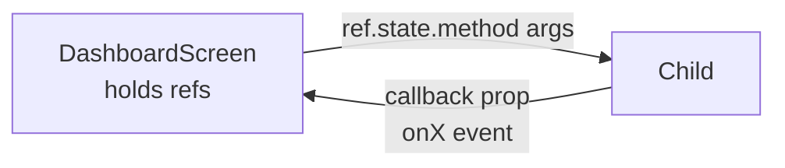

# Architecture Reference-`src/csr/`

This document is a snapshot of the **client-side rendering (CSR)** layer of Archivar.
It is scoped to two questions only:

1. **How do UI updates work correctly?**-state management, reactivity, routing,
   and inter-component communication.
2. **How do RPC calls work correctly?**-protocol, transport, long-running
   operations, authentication, error handling, and uploads.

For each file the *purpose* and the *key concerns* relevant to those two questions
are described. No source code is reproduced here; follow the clickable links.

---

## Foundational mechanisms

Before the per-file walkthrough, the cross-cutting mechanisms are summarised here
so the per-file sections can refer back to them concisely.

### UI update model

The CSR layer is built on the **`defuss`** framework. Three reactivity primitives
are in play:

- **Stores** via [`createStore`](src/csr/stores/auth-store.ts:9). A store is a
  small observable container with `.value`, `.set()`, `.subscribe()`,
  `.persist()`, and `.restore()`. Stores are used for **cross-screen** state
  (currently only auth).
- **Refs** via `createRef`. A ref is a handle to a DOM element *and* an attached
  imperative API surface (`ref.state`). The dashboard's child components expose
  their update methods through `ref.state.<method>()`. The parent holds refs and
  calls those methods directly-this is the primary intra-dashboard
  communication channel.
- **Imperative DOM patching** via the `$()` helper (a jQuery-like wrapper).
  Components re-render themselves by calling `$(someRef).update(<vdom/>)`,
  `$(someRef).css(...)`, `$(someRef).empty()`, etc. There is **no global virtual
  DOM diff**-each component owns a DOM subtree and patches it on demand.

Component communication is therefore **bidirectional but explicit**:

- Parent → child: parent calls `childRef.state.someMethod(...)`.
- Child → parent: child invokes a callback prop (e.g. `onFileChange`,
  `onTimeSeek`, `onCaptionRequested`).

### Routing model

Routing is declarative via [`Router`](src/csr/router.tsx:44) /
[`RouterOutlet`](src/csr/router.tsx:20). `RouterSlot` renders the outlet, which
checks the [`authStore`](src/csr/stores/auth-store.ts:9) and emits
`<Redirect>` guards. Screens are mounted inside `<Route>` blocks. Navigation is
performed imperatively via `Router.navigate(path)` (used by login and logout
flows).

### RPC model

- **Protocol:** [`defuss-rpc`](https://github.com/drag-coding/defuss-rpc). The
  client obtains a typed proxy via
  [`getRpcClient<RpcApi>()`](src/csr/screens/dashboard.tsx:25). Each server API
  class (e.g. `FileApi`) is instantiated client-side with `new rpc.FileApi()`;
  calling a method serialises arguments with **DSON** (`defuss-dson`) and POSTs
  to `/rpc`. The server's whitelist + guard hook in
  [`src/rpc.ts`](src/rpc.ts:35) authorises each call.
- **Single instance per API:** API objects (`fileApi`, `analyseApi`, `mllmApi`,
  `cacheApi`) are created once at module scope and reused across all calls in
  that module.
- **Long-running operations:** There is **no polling or WebSocket** for analysis.
  [`runWorkflow`](src/csr/screens/dashboard/upload-wizard.tsx:765) is a single
  blocking `await` on an RPC call that may run for many minutes. Live progress
  comes from a second, concurrent RPC: the generator method
  `FileApi.tailDebugLog` streams the workflow's `debug.log` line by line
  (defuss-rpc `async *` → NDJSON). The upload wizard's step 5 renders one
  `<progress>` bar driven by a real progress model
  ([`processing-status.ts`](src/csr/lib/processing-status.ts)): log events
  disclose totals (segments once pre-processing is done, slices per
  post-processing plugin) and move the bar deterministically within phase
  windows (5→15 pre, 15→70 processing, 70→95 post); phases without disclosed
  totals creep within their window, and the final aggregation/formatting tail
  (STEP 9–10) shows a spinner with a "finalizing" note. A status line is
  driven by RegExp matching on the streamed lines
  ([`matchProcessingLine`](src/csr/lib/processing-status.ts), prefixed ⏳
  while running / 🎉 when done), and an auto-scrolling log view shows the
  trailing lines. Real progress of the upload
  phase comes from the binary transport (see below).
- **Uploads:** Use a **binary HTTP transport**, not RPC. See
  [`upload-client.ts`](src/csr/lib/upload-client.ts:52).
- **Authentication:** Login is an RPC call to
  [`AuthApi.login`](src/csr/screens/login.tsx:120). On success the user object is
  stored in the defuss auth store and persisted to `sessionStorage`. The store
  also mirrors the user into `window.$APP_PROPS`. The server-side guard in
  [`src/rpc.ts`](src/rpc.ts:76) checks the `Authorization` header; calls not on
  the [`rpcCallWhitelist`](src/rpc.ts:35) require it. Note: the CSR client does
  not manually attach auth headers to RPC calls-`defuss-rpc` is expected to
  carry session/token state transparently.
- **Error handling:** Per call site. Login failures render an inline error box;
  analysis failures are caught and surfaced as error captions or modal error
  panels; upload failures yield `status: "error"` progress frames.

---

## `router.tsx`

[`src/csr/router.tsx`](src/csr/router.tsx)

**Purpose:** The top-level CSR entry. Loads i18n dictionaries, selects the active
language from `sessionStorage`, and declares the route table that decides which
screen renders.

**Key Concerns:**

- **UI updates:** [`RouterOutlet`](src/csr/router.tsx:20) reads
  [`authStore.value`](src/csr/stores/auth-store.ts:9) synchronously on every
  render. Authenticated users hitting `/` are redirected to `/dashboard`;
  unauthenticated users hitting `/dashboard` are redirected to `/`. Because the
  store is observable, login/logout transitions trigger a re-evaluation of these
  guards.
- **Routing:** Uses `defuss`'s `<Route>`, `<Redirect>`, and `<RouterSlot>`.
  Programmatic navigation (`Router.navigate("/dashboard")`) is used by the login
  handler and the logout link inside the dashboard.
- **i18n bootstrap:** [`loadLanguage`](src/csr/router.tsx:16) registers `de`/`en`
  dictionaries and [`changeLanguage`](src/csr/router.tsx:18) restores the user's
  choice from `sessionStorage` (key `archivar-lang`, default `de`). All
  subsequent `t(...)` calls resolve against this active language. The switcher
  is [`LanguageDropdown`](src/csr/components/language-dropdown.tsx), rendered
  top right by PreAuthLayout and by the dashboard SidebarHeader; the dashboard
  instance passes `reloadOnChange` because its strings are one-shot `t()`
  calls that only re-render on a fresh page load.

---

## `stores/auth-store.ts`

[`src/csr/stores/auth-store.ts`](src/csr/stores/auth-store.ts)

**Purpose:** The only global store in the CSR layer. Holds the authenticated
[`User`](src/models/user.ts) and `isLoggedIn` flag, persists the session, and
mirrors the user into `window.$APP_PROPS` for any non-defuss code that needs it.

**Key Concerns:**

- **UI updates:** Created with [`createStore<AuthState>`](src/csr/stores/auth-store.ts:9).
  Components read `authStore.value` reactively. The
  [`subscribe`](src/csr/stores/auth-store.ts:18) callback keeps
  `window.$APP_PROPS.user` in sync on every state change.
- **Session persistence:** [`restore`](src/csr/stores/auth-store.ts:15) loads
  from `sessionStorage` (key `archivar_auth`) on module load, so a page reload
  keeps the user logged in for the lifetime of the browser tab.
  [`loginUser`](src/csr/stores/auth-store.ts:33) and
  [`logoutUser`](src/csr/stores/auth-store.ts:38) both call `set` then
  [`persist`](src/csr/stores/auth-store.ts:35) to write through.
- **RPC tie-in:** The store itself performs no RPC; it is mutated by
  [`LoginScreen`](src/csr/screens/login.tsx:123) after a successful
  [`AuthApi.login`](src/rpc/auth.ts) call.

---

## ~~`actions/actions.ts`~~ / ~~`actions/full-analysis.ts`~~ (removed)

Both modules were removed: their only consumer was the dashboard's Actions
panel, which was permanently hidden (`display: 'none'`)-the legacy
client-side analysis path, superseded by server-side workflows (upload wizard
/ analyze modal). The panel, its `ActionsRef` machinery, and the orphaned
i18n keys went with them.

---

## `lib/upload-client.ts`

[`src/csr/lib/upload-client.ts`](src/csr/lib/upload-client.ts)

**Purpose:** The binary upload transport. Provides an async-generator
[`uploadFile`](src/csr/lib/upload-client.ts:52) that streams
[`UploadProgress`](src/csr/lib/upload-client.ts:5) frames to the UI, plus
[`checkFileExists`](src/csr/lib/upload-client.ts:38) for the pre-flight check
and [`uploadFileComplete`](src/csr/lib/upload-client.ts:208) /
[`cancelUpload`](src/csr/lib/upload-client.ts:222) helpers.

**Key Concerns:**

- **Protocol-chunked binary POSTs + server-side assembly:** files are
  uploaded in 24 MiB slices (`CHUNK_SIZE`), each an independent
  `fetch(POST /rpc/upload)` with `X-Upload-Handler: file-chunk` and
  `X-Upload-Id: <uploadId>-c<index>`, followed by the
  `FileApi.finalizeChunkedUpload` RPC which concatenates the chunks
  server-side in seconds. WHY chunked: a fronting proxy
  kills any request whose upstream stays silent for
  ~60s (verified: 502 after exactly 60.3s)-a multi-hundred-MB single POST
  over a slow uplink never survives, regardless of transport. The server
  side lives in [`src/rpc/file-upload-api.ts`](src/rpc/file-upload-api.ts)
  (handler + `assembleChunkedUpload`/`discardChunkedUpload`); the legacy
  single-shot `file-upload` handler remains for compatibility.
- **Transport-fetch, never XHR:** chunk bodies stream straight from
  `File.slice()`; nothing is buffered client-side. An earlier XHR-based
  transport (`xhr.send(file)`, chosen for its `upload.onprogress`) broke
  huge uploads (~700MB) in the browser and was removed in 2026-08.
- **Progress reporting-per-chunk server-side SSE:** fetch() cannot observe
  upload progress, so each chunk opens an EventSource on
  `/rpc/upload/progress/<chunkUploadId>` and maps the server's receive
  progress onto the file's overall byte range. SSE is best-effort: if a
  proxy buffers or blocks it, the upload still completes-only the bar
  stands still. In dev this requires the streaming bypass in
  [`astro.config.ts`](astro.config.ts) (`rpcUploadStreamingPlugin`): Astro's
  dev SSR pipeline fully buffers request bodies before routes run, so the
  middleware intercepts `POST /rpc/upload` and `GET /rpc/upload/progress/*`
  ahead of Astro and hands the raw Node stream to `rpcRoute`-live `.part`
  growth, flat RSS, working SSE. The bypass also sets
  `httpServer.requestTimeout = 0` (Node's 300s default would kill long
  transfers).
- **Verified confirmation:** after the last chunk, the
  `finalizeChunkedUpload` RPC must return the assembled file's metadata -
  `confirmed` (100%) is yielded only then; a handler error frame, a failed
  chunk, or a finalize failure yields `error` and triggers best-effort
  server-side chunk cleanup. The wizard's step gate requires this verified
  `confirmed` status before advancing.
- **Pre-flight:** [`checkFileExists`](src/csr/lib/upload-client.ts:38) uses the
  RPC `FileApi.checkFileExists` (whitelisted in
  [`src/rpc.ts`](src/rpc.ts:67)) to warn the user before overwriting.
- **Error handling:** transport failures yield an `error` progress frame with
  `errorCode: "upload_failed"`, HTTP non-ok responses with `errorCode:
  "http_<status>"`. Handler-side error frames carry the server's message.
  Cancellation is currently a no-op stub-the user is expected to cancel
  before the fetch starts.
- **Single shared RPC client:** [`getClient`](src/csr/lib/upload-client.ts:27)
  memoises the `getRpcClient` result so the pre-flight check reuses the same
  connection.

---

## `lib/markdown.ts`

[`src/csr/lib/markdown.ts`](src/csr/lib/markdown.ts)

**Purpose:** Thin wrapper around [`marked`](https://marked.js.org/) that converts
Markdown to HTML for the dashboard's caption/summary panels.

**Key Concerns:**

- **UI updates:** [`renderMarkdown`](src/csr/lib/markdown.ts:24) returns an HTML
  string. Callers (e.g. [`events-list`](src/csr/screens/dashboard/events-list.tsx:298),
  [`transcription-view`](src/csr/screens/dashboard/transcription-view.tsx:310),
  [`summary-view`](src/csr/screens/dashboard/summary-view.tsx:147)) inject the
  HTML via `innerHTML` inside a `requestAnimationFrame` callback **after** the
  defuss VDOM commit. This two-step pattern is required because defuss does not
  re-render raw HTML strings as DOM-the `.markdown-content` element is
  rendered empty by the VDOM and then populated imperatively.
- **Security note:** Renders **trusted** plugin/server-generated content only,
  not user input. GFM and line-break options are enabled.
- **Normalization before rendering:** [`normalizeMarkdown`](src/csr/lib/markdown.ts)
  repairs two model-emission failure modes: (a) heading/paragraph glued to a
  table start on the SAME line ("# Visuelle Artefakte | Artefakt | …") is split
  at the first `|` into prefix + blank line + table row (`splitGluedTableStarts`,
  fenced code blocks and lines already starting with `|` untouched); (b) a
  delimiter row with fewer cells than the header is padded to the header's
  column count (marked v18 silently drops such tables).

---

## `layouts/pre-auth.tsx`

[`src/csr/layouts/pre-auth.tsx`](src/csr/layouts/pre-auth.tsx)

**Purpose:** The two-column pre-authentication shell: branding, theme switcher,
language dropdown, and a slot for the login form.

**Key Concerns:**

- **UI updates:** A pure presentational wrapper. It renders `{children}` (the
  [`LoginScreen`](src/csr/screens/login.tsx)) and the
  [`LanguageDropdown`](src/csr/components/language-dropdown.tsx). Theme switching
  is delegated to a `<uk-theme-switcher>` web component.
- **RPC / state:** None directly. Auth state changes are driven by the child
  login form.

---

## `screens/login.tsx`

[`src/csr/screens/login.tsx`](src/csr/screens/login.tsx)

**Purpose:** The login screen: email/password form with client-side validation
(via `defuss-transval`) and server-side authentication.

**Key Concerns:**

- **UI updates:**
  - Form state is managed with `defuss-transval`'s
    [`access`](src/csr/screens/login.tsx:69) / [`transval`](src/csr/screens/login.tsx:72)
    for declarative validation.
  - Validation errors are rendered imperatively: `clearErrorStyles` and
    [`renderFieldError`](src/csr/screens/login.tsx:89) use `$()` to patch
    `[data-field-error]` containers and toggle `uk-form-destructive` classes.
  - A general error box is rendered via
    [`renderErrorBox`](src/csr/screens/login.tsx:48) into `errorContainerRef`.
- **RPC flow:**
  - On valid submit, [`handleSignIn`](src/csr/screens/login.tsx:109) calls
    [`AuthApi.login(email, password)`](src/csr/screens/login.tsx:120) via a
    fresh `getRpcClient<RpcApi>()` instance.
  - **Success:** calls [`loginUser(user)`](src/csr/stores/auth-store.ts:33) to
    update the auth store + persist session, shows a success notification, and
    navigates to `/dashboard` via `Router.navigate`. The auth store change is
    what flips the router guards.
  - **Failure:** renders the server's `result.error` (or a default i18n message)
    in the error box and shows a destructive notification.
- **Validation rules:** Custom
    [`LoginValidators`](src/csr/screens/login.tsx:22) add an async blacklist
    check and strong-password rules; these run entirely client-side.

---

## `screens/dashboard.tsx`

[`src/csr/screens/dashboard.tsx`](src/csr/screens/dashboard.tsx)

**Purpose:** The main authenticated screen. Orchestrates the entire dashboard:
file list, media canvas, timeline, events list, transcription/summary views,
upload wizard, analyze modal, and confirm dialog. Also exports the RPC wrapper
helpers (`listFiles`, `captionVideos`, `captionAudios`, `captionImage`,
`captionSound`, `browseInputFiles`) used by the action modules.

**Key Concerns-UI updates:**

- **Imperative child orchestration:** Holds `createRef` handles for every child
  component ([`DashboardScreen`](src/csr/screens/dashboard.tsx:75)) and drives
  them via `ref.state.*` calls. This is the central coordination point.
- **File selection flow** ([`onFileChange`](src/csr/screens/dashboard.tsx:541)):
  when [`FileList`](src/csr/screens/dashboard/file-list.tsx) raises
  `onFileChange`, the parent:
  1. Marks the file selected (`fileSelectedRef.updateState`) and sets
     `exportFileNameStore` for the download links.
  2. Swaps the media source on
     [`MediaCanvas`](src/csr/screens/dashboard/media-canvas.tsx) via
     `changeSrc` / `changeType` / `changeKeyframes`.
  3. Resets the timeline transport to 0.
  4. Builds audio + scene region arrays from `FileInfo`, deduplicates them, and
     pushes them to [`Timeline`](src/csr/screens/dashboard/timeline.tsx) via
     `updateAudioRegions` / `updateSceneRegions`.
  5. Derives [`EventItem`](src/csr/screens/dashboard/events-list.tsx:31)s via
     [`createEventsFromRegions`](src/csr/screens/dashboard.tsx:210) and loads
     v3 semantic aggregations + summaries from the cache.
  6. Updates [`EventsList`](src/csr/screens/dashboard/events-list.tsx),
     [`TranscriptionView`](src/csr/screens/dashboard/transcription-view.tsx),
     and [`SummaryView`](src/csr/screens/dashboard/summary-view.tsx).
- **Loading overlays:** A shared `LoadingOverlay` (`Spinner`-a neutral ring
  rotating via the `.app-spinner` CSS transform animation in
  base.css-plus `common.loading` label, `absolute inset-0` over a
  `relative` container) blocks regions while
  their data loads, driven by two stores: `fileListLoadingStore` (initially
  true-covers the sidebar file list during the initial
  [`browseInputFiles`](src/csr/screens/dashboard.tsx:62), refresh, delete and
  upload-complete reloads) and `fileChangeLoadingStore` (set by `onFileChange`
  around the whole `loadFileData` body via try/finally-covers the timeline
  and the entire right-hand tab column while a file's data loads).
- **Playback synchronisation** ([`onMediaProgress`](src/csr/screens/dashboard.tsx:205)):
  on each 25 ms tick from the media element, the parent forwards the current
  time to `timelineRef.state.updateTransport` and
  `eventsListRef.state.filterEventsByTime`, keeping the timeline cursor and the
  "current events" list in lockstep with playback.
- **Seek coordination** ([`onTimelineClick`](src/csr/screens/dashboard.tsx:282) /
  [`onTimeSeek`](src/csr/screens/dashboard.tsx:295)): a click anywhere on the
  timeline or a time-badge click in a list seeks the media
  (`mediaCanvasRef.state.seekToMs`), updates the transport, and re-filters
  events-all three children are updated together.
- **Captioning flow** ([`onCaptionRequested`](src/csr/screens/dashboard.tsx:302)
  and [`onAnalyzeModalConfirm`](src/csr/screens/dashboard.tsx:420)): on user
  request, issues a captioning RPC (via the exported helpers), writes the result
  to the appropriate cache table (`scene`/`keyframe`/`speech`/`audio`), and
  calls `eventsListRef.state.updateCaption` to render it.
- **Tab switching:** Five tabs (Current Events, All Results, Log, Raw Output,
  Summary) are toggled by adding/removing `uk-active` and
  setting `display: flex/none/block` on the corresponding display refs. The Log
  and Raw Output tabs are hidden (`display:none` on their `<li>`); their
  handlers and content remain-they lazily fetch
  `debug.log` / `debug.json` via
  [`fileApi.readFile`](src/csr/screens/dashboard.tsx:925) when opened.
  (The permanently hidden, never-functional CaptionGPT tab was removed.)
- **Result exports:** The "All Results" tab header hosts a Download dropdown
  (`uk-dropdown`) with four links to
  `GET /api/export?file=…&format=docx|md|json|log`-the server generates (or
  reuses) the export and streams it as an attachment. The docx/md/json links
  pass `view=filtered`, so downloads contain the reduced result view (docx/md:
  summary + higherOrderAggregations; json: the `toJsonDownload` transformer
  shape-see [`src/lib/result-view.ts`](src/lib/result-view.ts)); the log
  link is unfiltered. The links are driven by a
  module-scope defuss store
  [`exportFileNameStore`](src/csr/screens/dashboard.tsx:866), set in
  `onFileChange`; the labels come from the i18n keys
  `dashboard.export_format_word/markdown/json/log`.
  The `Reactive` render never returns `null` (defuss `jsx()` throws
  "Invalid JSX input" on null)-it renders a hidden `` when no file is
  selected. Left of the download button sits a static AI-disclosure note
  (frontend-only; i18n keys `dashboard.ai_disclosure_label`-bold-and
  `dashboard.ai_disclosure`) stating that all analysis results are fully
  AI-generated and should be verified.
- **Filtered view for "All Results":** After loading the `aggregated` cache
  entry, the dashboard derives a reduced view via
  [`toResultView()`](src/lib/result-view.ts) (which also strips the aggregated
  artifact/perception tables from HOA descriptions) and feeds only that to the
  summary/HOA setters; the TranscriptionView receives no events, so "All
  Results" renders summary + higher-order aggregations only. The full cache
  entry still drives timeline regions and event captions (needed by the
  timeline and "Current Events").
- **Column resize/collapse:** Double-clicking a resize handle toggles the left
  or right column and adjusts the middle column's `flex-basis`
  ([`updateMiddleColumnSize`](src/csr/screens/dashboard.tsx:975)).
- **Initial load:** [`queueMicrotask`](src/csr/screens/dashboard.tsx:813) calls
  [`browseInputFiles`](src/csr/screens/dashboard.tsx:62) (which issues four
  `listFiles` RPCs in parallel) and populates the file list.
- **Logout:** Calls [`logoutUser()`](src/csr/stores/auth-store.ts:38) then
  `Router.navigate("/")`.

**Key Concerns-RPC flow:**

- A single [`getRpcClient<RpcApi>()`](src/csr/screens/dashboard.tsx:25) is
  awaited at module scope; `fileApi`, `analyseApi`, `mllmApi`, and `cacheApi`
  are instantiated once and shared.
- Exported helpers are thin wrappers:
  - [`listFiles`](src/csr/screens/dashboard.tsx) → `fileApi.listFiles`.
  - [`captionVideos`](src/csr/screens/dashboard.tsx) → `mllmApi.captionVideos`.
  - [`captionAudios`](src/csr/screens/dashboard.tsx) → `mllmApi.captionSound`
    (ASR transcription route; server resolves the default workflow's ASR model).
  - [`captionImage`](src/csr/screens/dashboard.tsx) → `mllmApi.captionImage`.
  - [`captionSound`](src/csr/screens/dashboard.tsx) → `mllmApi.captionSound`
    (explicit model, or the configured default ASR model when omitted).
- **Delete:** [`fileApi.deleteFile`](src/csr/screens/dashboard.tsx:1038) followed
  by a file-list refresh.
- **Cache reads for v3 summaries/aggregations:** Uses
  [`cacheApi.getAnalysisViewByHash(outputHash)`](src/rpc/cache-api.ts)-one
  lean server-shaped [`AnalysisView`](src/lib/analysis-view.ts) per file click
  (captions, aggregation/HOA regions, filtered summary view, provenance); the
  preferred-plugin key (`question-answer` first) is chosen
  server-side. Replaced the multi-MB `getByKeySubstring("aggregated", …)`
  full-result transfer.

---

## `screens/dashboard/file-list.tsx`

[`src/csr/screens/dashboard/file-list.tsx`](src/csr/screens/dashboard/file-list.tsx)

**Purpose:** Sidebar table of input files with select / refresh / upload / delete
actions.

**Key Concerns-UI updates:**

- Exposes [`FileListRef`](src/csr/screens/dashboard/file-list.tsx:4) with
  `setFiles`, `setSelectedFile`, and a `selectedFile` field. The parent calls
  `setFiles` after browsing or after upload/delete.
- Selection (row click or programmatic `setSelectedFile(entry)`) goes through
  one shared `selectFile` helper: highlight the row, enable the delete button
  via [`updateDeleteButton`](src/csr/screens/dashboard/file-list.tsx:25), fire
  the `onFileChange` callback prop, and scroll the row into view
  (`scrollIntoView({ block: "nearest" })`). `setSelectedFile(null)` only
  clears the selection (post-delete path).
- Rendering is done with [`$(fileListTableRef).update(vdom)`](src/csr/screens/dashboard/file-list.tsx:56).

**Key Concerns-RPC:** None directly; all RPCs are issued by the parent via
the callback props (`onRefreshClick`, `onFileDelete`).

---

## `screens/dashboard/media-canvas.tsx`

[`src/csr/screens/dashboard/media-canvas.tsx`](src/csr/screens/dashboard/media-canvas.tsx)

**Purpose:** Renders the currently selected media (video / image / audio / kfs
keyframe gallery) and reports playback progress and metadata.

**Key Concerns-UI updates:**

- Exposes [`MediaCanvasRef`](src/csr/screens/dashboard/media-canvas.tsx:11) with
  `play`, `pause`, `seek`, `seekToMs`, `volume`, `mute`/`unmute`, `changeSrc`,
  `changeType`, `changeKeyframes`.
- [`updateMediaElement`](src/csr/screens/dashboard/media-canvas.tsx:97) is the
  single re-render routine: it rebuilds the appropriate `<video>`/``/
  `<audio>`/keyframe-gallery VDOM and commits it via `$(contentRef).update(...)`,
  then re-attaches media event listeners (`loadedmetadata`, `play`, `pause`,
  `ended`, `seeking`, `seeked`) inside a `$(() => ...)` callback.
- **Progress reporting:** [`startProgressTracking`](src/csr/screens/dashboard/media-canvas.tsx:45)
  runs a 25 ms `setInterval` that calls `onProgress(currentTimeMs)`-this is
  the heartbeat that drives timeline + events-list synchronisation.
- **External seek guard:** `seekToMs` sets `isExternalSeek = true` to suppress
  the next progress tick, preventing feedback loops between the timeline click
  and the media element's own seeking events.

**Key Concerns-RPC:** None. Media URLs (`serverUrl`) are resolved by the
browser via normal HTTP; no RPC is involved in playback.

---

## `screens/dashboard/timeline.tsx`

[`src/csr/screens/dashboard/timeline.tsx`](src/csr/screens/dashboard/timeline.tsx)

**Purpose:** A horizontally-scrollable timeline showing minute/second markers,
audio regions, scene regions, and semantic aggregation regions, plus a
draggable transport cursor.

**Key Concerns-UI updates:**

- Exposes [`TimelineRef`](src/csr/screens/dashboard/timeline.tsx:33) with
  `updateTransport`, `updateTimeframe`, `updateAudioRegions`,
  `updateSceneRegions`, `updateAggregationRegions`, `scrollToTransport`.
- Each update method re-renders only its own layer (markers, audio, scene, or
  aggregation) via `$(<layer>Ref).update(vdom)`, then adjusts widths/positions
  with `$(...).css(...)`. This is partial DOM patching-not a full re-render.
- Click handling ([`handleTimelineClick`](src/csr/screens/dashboard/timeline.tsx:65))
  converts pixel offset → milliseconds using `pixelsPerSecond` and invokes
  `onTimelineClick(timeMs)`; the parent then coordinates the media seek and
  events filter.
- Auto-scroll keeps the transport cursor ~300 px from the left edge.

**Key Concerns-RPC:** None.

---

## `screens/dashboard/events-list.tsx`

[`src/csr/screens/dashboard/events-list.tsx`](src/csr/screens/dashboard/events-list.tsx)

**Purpose:** The "Current Events" tab. Lists events active at the current media
time, shows a caption panel, and embeds a
[`SceneVisualization`](src/csr/screens/dashboard/scene-visualization.tsx). Also
hosts the "Analyze" button that opens the
[`AnalyzeModal`](src/csr/screens/dashboard/analyze-modal.tsx).

**Key Concerns-UI updates:**

- Exposes [`EventsListRef`](src/csr/screens/dashboard/events-list.tsx:45) with
  `updateEvents`, `filterEventsByTime`, and `updateCaption`.
- [`filterEventsByTime`](src/csr/screens/dashboard/events-list.tsx:449) sets
  `currentTimeMs`, clears the activation state, and re-renders the table body
  via `$(tableBodyRef).update(renderEvents(allEvents))`.
- The table renders higher-order aggregation (H-*) rows only:
  [`VISIBLE_EVENT_TYPES`](src/csr/screens/dashboard/events-list.tsx:34) is an
  empty set that filters all regular event rows (speech/scene/keyframe/
  noise/harmonic/silence/semanticAggregation) out of the table-including
  their per-event download buttons. HOA rows still render and remain clickable;
  data loading and the timeline are unaffected.
- Event clicks ([`handleEventClick`](src/csr/screens/dashboard/events-list.tsx:154))
  set `selectedEvent`/`clickedEventId`, optionally load a cached caption, update
  the caption panel, and update the embedded scene visualization.
- The caption panel is rendered with a `.markdown-content` placeholder; the
  actual HTML is injected via `requestAnimationFrame` +
  [`renderMarkdown`](src/csr/lib/markdown.ts:24) after the VDOM commit.

**Key Concerns-RPC:**

- Maintains its own [`cacheApi`](src/csr/screens/dashboard/events-list.tsx:23)
  instance to lazily hydrate captions on event click
  ([`handleEventClick`](src/csr/screens/dashboard/events-list.tsx:159)).
- Captioning and modal analysis are delegated to the parent via the
  `onCaptionRequested` and `onAnalyzeModalOpen` callback props; this module does
  not issue captioning RPCs itself.

---

## `screens/dashboard/transcription-view.tsx`

[`src/csr/screens/dashboard/transcription-view.tsx`](src/csr/screens/dashboard/transcription-view.tsx)

**Purpose:** The "All Results" tab. Renders the filtered result view: the
summary header (title, keywords, tags, short_description, abstract,
long_summary, categorization, overallIntention, narrativeArc, perceptionArc -
each only when present), higher-order aggregations (descriptions rendered
without the aggregated artifact/perception tables, already stripped by
[`toResultView()`](src/lib/result-view.ts)), and a provenance footer at the
bottom (File, Workflow, Exported = render time, ASR/VLM Model from
`status.json` via `StatusApi.getStatus`, Processing time summed from the full
result's `timing` via
[`summarizeProcessingTime()`](src/lib/result-view.ts)). The dashboard passes no
events, so the chronological event list capability below is currently unused
by the dashboard.

**Key Concerns-UI updates:**

- Exposes [`TranscriptionViewRef`](src/csr/screens/dashboard/transcription-view.tsx:26)
  with `updateEvents` (async), `setSummary`, `setHigherOrderAggregations` and
  `setProvenance` (footer metadata).
- [`updateEvents`](src/csr/screens/dashboard/transcription-view.tsx:326)
  renders immediately with whatever captions are present, then asynchronously
  enriches events with captions from the cache
  ([`loadCaptionsFromCache`](src/csr/screens/dashboard/transcription-view.tsx:258))
  and re-renders. The backfill issues ONE hash-scoped call,
  [`cacheApi.getCaptionsByHash(hash)`](src/rpc/cache-api.ts) (only the selected
  file's `cacheId → caption` map)-it replaced four full-table `getAll`
  fetches (~8 MB → a few KB–hundred KB per click).
- Markdown injection uses the same `requestAnimationFrame` +
  `data-md-caption` attribute pattern as the events list.

**Key Concerns-RPC:** Read-only cache access via
[`cacheApi`](src/csr/screens/dashboard/transcription-view.tsx:20)
(`getCaptionsByHash`).

---

## `screens/dashboard/summary-view.tsx`

[`src/csr/screens/dashboard/summary-view.tsx`](src/csr/screens/dashboard/summary-view.tsx)

**Purpose:** The "Summary" tab. Renders a structured summary (title, abstract,
keywords, tags, categorization, overallIntention, narrativeArc, perceptionArc,
short/long summary, quality attributes) from the v3 plugin result. The
renderer stays tolerant of old cache entry shapes.

**Key Concerns-UI updates:**

- Exposes [`SummaryViewRef`](src/csr/screens/dashboard/summary-view.tsx:5) with
  `loadV3Summary(summary)` and `clear`.
- The loader renders the summary VDOM into `contentRef` and then injects the
  `long_summary` markdown via `requestAnimationFrame`.
- The parent calls [`loadV3Summary`](src/csr/screens/dashboard/summary-view.tsx:122)
  when a v3 post-processing summary exists and makes the Summary tab visible.

**Key Concerns-RPC:** None; the summary data is passed in by the parent.

---

## `screens/dashboard/upload-wizard.tsx`

[`src/csr/screens/dashboard/upload-wizard.tsx`](src/csr/screens/dashboard/upload-wizard.tsx)

**Purpose:** A 5-step modal wizard: (1) upload a file, (2) choose a workflow,
(3) configure per-clip-type models/prompts, (4) configure post-processing
(plugins), (5) run the workflow with live progress.

**Key Concerns-UI updates:**

- Exposes [`UploadWizardRef`](src/csr/screens/dashboard/upload-wizard.tsx:22)
  with `open(preSelectedFile?)` / `close`. The `open` method now accepts an
  optional [`FileInfo`](src/rpc/file-api.ts:8) parameter. When a pre-selected
  file is provided and it has no `outputFolderName` (i.e., not yet processed),
  the wizard auto-selects it and shows the "Or choose $filename" button in step 1,
  allowing the user to skip the upload phase entirely.
- The wizard does **not** use the `ref.state` patching pattern for its body.
  Instead, each step has its own `renderStepN()` function and
  [`renderCurrentStep`](src/csr/screens/dashboard/upload-wizard.tsx:858) wipes
  `wizardBodyRef.current.innerHTML` and calls
  `render(stepContent, wizardBodyRef.current)` from `defuss/client`. The step
  indicator and footer buttons are likewise re-rendered on every state change.
- [`canAdvance`](src/csr/screens/dashboard/upload-wizard.tsx:98) computes
  per-step validity (file selected + upload started; workflow chosen; enabled
  clip types with valid prompts; etc.) and drives button disabled state via
  [`updateButtons`](src/csr/screens/dashboard/upload-wizard.tsx:117).
- Step 3 shows only the modality tabs compatible with the selected file's media
  type: `getAllAnalysisDefaults` marks each step with a `compatible` flag
  (scene → video, keyframe → video+image, speech/harmonic/noise/silence →
  video+audio) and `fetchDefaults` drops incompatible steps from
  `clipTypeConfigs`, so their tabs/panes are never rendered. Omitting them from
  the run payload is safe because the engine replaces `workflow.processing`
  wholesale with the client overrides.
- Prompt UI and the expert (system-prompt) toggle are hidden in this dialog
  only, behind the module-level `SHOW_PROMPT_CONTROLS = false` flag (code kept,
  not removed). Prompt values still flow from the fetched defaults into the run
  payload.
- The header carries an always-visible X close button. It deliberately avoids
  `data-uk-close` (which would bypass the cancel guards) and instead calls the
  same guarded close path as the footer Cancel button.
- While processing runs (step 5), all close/navigation paths are inert: the
  step-indicator pills ignore clicks, the footer Back button is hidden, the X
  button is disabled (patched imperatively in `updateButtons`), and a
  once-registered `beforehide` listener blocks ESC via `e.preventDefault()`.
- Post-processing checkboxes (step 4) are readonly: states are forced
  `enabled: true` on fetch and the inputs render `disabled`.
- Modal show/hide uses the UIkit modal API
  (`uk.modal(el).show()`/`.hide()`).

**Key Concerns-RPC flow:**

- **Step 1 (upload):** [`startRealUpload`](src/csr/screens/dashboard/upload-wizard.tsx:294)
  consumes the [`uploadFile`](src/csr/lib/upload-client.ts:52) async generator
  and updates `uploadProgress`/`uploadStatus` on each frame. Pre-flight
  existence check via [`checkFileExists`](src/csr/lib/upload-client.ts:38).
- The server stores uploads under a **sanitized** name
  ([`sanitizeFileName`](src/rpc/file-upload-api.ts:33): every char outside
  `a-zA-Z0-9._-` becomes `_`). The wizard learns the on-disk name from
  `checkFileExists`' `safeName` (or from the pre-selected file) in
  `serverFileName` and routes every RPC (`getAllAnalysisDefaults`,
  `runWorkflow`, `clearFileCache`, `onUploadComplete`) through
  `onDiskFileName()`; `selectedFile.name` is display-only.
- **Step 2 (workflows):** [`fetchWorkflows`](src/csr/screens/dashboard/upload-wizard.tsx:916)
  calls [`analyseApi.listWorkflows`](src/rpc/analyse-api.ts).
- **Step 3 (defaults):** [`fetchDefaults`](src/csr/screens/dashboard/upload-wizard.tsx:366)
  calls [`analyseApi.getAllAnalysisDefaults`](src/rpc/analyse-api.ts) for the
  selected workflow + file name, populating per-media-type model/prompt defaults.
  Steps flagged `compatible: false` server-side are dropped from the tab bar.
  Three render states: spinner while loading, an error note when the RPC
  rejects (`defaultsError`), and a "no compatible steps" note when the loaded
  list is empty (e.g. an image with a workflow that has no keyframe step) -
  both replaced the former fall-through to an eternal "Lädt...".
- **Step 4 (post-processing):** [`fetchPostProcessingDefaults`](src/csr/screens/dashboard/upload-wizard.tsx:573)
  calls [`analyseApi.getPostProcessingDefaults`](src/rpc/analyse-api.ts).
- **Step 5 (run):** [`startProcessing`](src/csr/screens/dashboard/upload-wizard.tsx:683)
  clears the file's cache first when re-processing an existing file (anything
  not uploaded in this wizard session-`FileApi.clearFileCache`, aborting on
  failure), then issues the single blocking RPC
  [`analyseApi.runWorkflow`](src/csr/screens/dashboard/upload-wizard.tsx:765)
  with the assembled processing + post-processing overrides. In parallel it
  consumes [`FileApi.tailDebugLog`](src/rpc/file-api.ts), an async-generator
  RPC that streams `<file>.archivar/debug.log` line by line: each line is
  appended to the auto-scrolling log view (terminal styling like the hidden
  dashboard Log tab) and matched by
  [`matchProcessingLine`](src/csr/lib/processing-status.ts) to update the
  status text (preprocessing/analysis/post-processing phases). The
  `<progress>` bar follows the real progress model in
  [`processing-status.ts`](src/csr/lib/processing-status.ts): determinate
  within phase windows (5→15 / 15→70 / 70→95) once the log discloses
  segment/slice totals, creeping otherwise; pinned to 100 on success. The
  step-5 DOM is rendered once and then patched
  imperatively-a
  `renderCurrentStep()` mid-run would wipe the appended log. When the RPC
  resolves, the bar is set to 100 and `onUploadComplete(fileName)` fires; the
  parent refreshes the file list, selects the just-processed file (same
  activation as a manual row click) and scrolls it into view. On error, an
  error banner is mounted above the log view, which stays visible.

---

## `screens/dashboard/analyze-modal.tsx`

[`src/csr/screens/dashboard/analyze-modal.tsx`](src/csr/screens/dashboard/analyze-modal.tsx)

**Purpose:** A modal for ad-hoc single-segment analysis: pick a workflow, model,
prompt, and system prompt, then run [`analyseApi.analyzeSegment`](src/rpc/analyse-api.ts).

**Key Concerns-UI updates:**

- Exposes [`AnalyzeModalRef`](src/csr/screens/dashboard/analyze-modal.tsx:38)
  with `open(fileInfo, detectionType)` / `close`.
- [`renderContent`](src/csr/screens/dashboard/analyze-modal.tsx:96) and
  [`renderFooter`](src/csr/screens/dashboard/analyze-modal.tsx:214) each patch
  their respective refs with `$(...).update(...)`. While analyzing, the footer
  shows a progress bar and the UIkit `beforehide` event is blocked to prevent
  dismissal.

**Key Concerns-RPC flow:**

- [`openModal`](src/csr/screens/dashboard/analyze-modal.tsx:265) issues two RPCs
  in parallel: [`analyseApi.listWorkflows`](src/rpc/analyse-api.ts) and
  [`analyseApi.getAnalysisDefaults`](src/rpc/analyse-api.ts) (for the detected
  media type).
- [`refetchDefaults`](src/csr/screens/dashboard/analyze-modal.tsx:77) re-queries
  defaults when the user changes the workflow dropdown.
- On confirm, the actual `analyzeSegment` RPC is issued by the **parent**
  ([`onAnalyzeModalConfirm`](src/csr/screens/dashboard.tsx:420)), not by this
  modal-the modal only collects the inputs and forwards them via the
  `onConfirm` callback.

---

## `screens/dashboard/confirm-dialog.tsx`

[`src/csr/screens/dashboard/confirm-dialog.tsx`](src/csr/screens/dashboard/confirm-dialog.tsx)

**Purpose:** A reusable promise-based confirmation modal.

**Key Concerns-UI updates:**

- Exposes [`ConfirmDialogRef`](src/csr/screens/dashboard/confirm-dialog.tsx:4)
  with `confirm(message): Promise<boolean>`. The promise resolves when the user
  clicks OK or Cancel (or the modal is otherwise dismissed).
- Uses the UIkit modal API for show/hide.

**Key Concerns-RPC:** None.

---

## `screens/dashboard/scene-visualization.tsx`

[`src/csr/screens/dashboard/scene-visualization.tsx`](src/csr/screens/dashboard/scene-visualization.tsx)

**Purpose:** A small media preview panel embedded in the events list. Renders a
`<video>`, ``, or `<audio>` element for the selected event's `FileInfo`,
plus a full-screen image lightbox.

**Key Concerns-UI updates:**

- Exposes [`SceneVisualizationRef`](src/csr/screens/dashboard/scene-visualization.tsx:4)
  with `updateScene(fileInfo, timeMs)` and `clearScene`.
- Both methods call [`renderSceneContent`](src/csr/screens/dashboard/scene-visualization.tsx:45)
  and patch `sceneContainerRef` via `$(...).update(...)`.
- The lightbox is toggled by mutating local `isModalOpen`/`modalImageUrl` state
  and re-rendering. The `Escape` key closes the lightbox via a global
  `keydown` listener.

**Key Concerns-RPC:** None.
