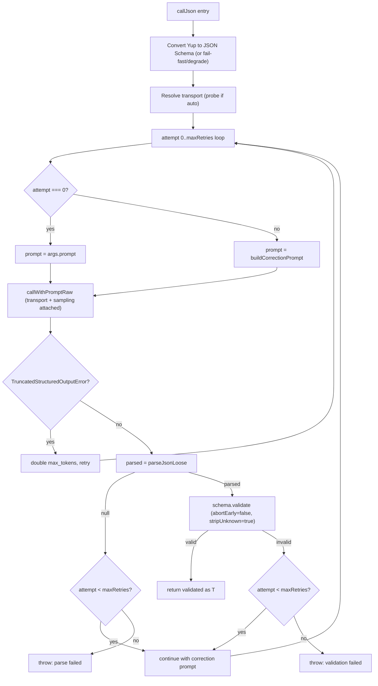

# JSON Output Mode-Current State of Implementation (Full Detail)

> **Scope:** Every code path where Archivar asks an LLM (vLLM /
> OpenAI-compatible backends) to return **structured JSON**-how that JSON is
> *enforced*, *parsed*, *validated*, and *retried*, with exact code citations.
>
> This is a snapshot of the current truth, not a changelog.
>
> **One-line truth:** Archivar enforces JSON output **via the resolved
> transport by default** (model-name registry → probe) but supports pinning
> **native JSON-schema constrained decoding** per model
> (`jsonSchemaMode: "auto" | "response_format" | "structured_outputs" |
> "legacy_guided_json"`, or `false` for prompt-only). When a native transport is
> attached, sampling is overridden (temp=0.2, presence_penalty=0, max_tokens
> capped at 16384) to avoid repetition loops with the grammar constraint. The
> Yup validation + prompt-based retry loop is **retained as a safety net** in
> `callJson()`.

---

## Table of Contents

1. [Decision snapshot](#1-decision-snapshot)
2. [Transport layer: `OpenAIChatRequest`](#2-the-transport-layer-openaichatrequest)
3. [LLM call entry points in `MllmApi`](#3-llm-call-entry-points-in-mllmapi)
4. [How JSON is enforced: native mode + prompt safety net](#4-how-json-is-enforced-native-mode--prompt-safety-net)
5. [JSON parsing-consolidated in `parse-json.ts`](#5-json-parsing--consolidated-in-parse-json)
6. [The retry algorithm (v3 plugin pipeline)](#6-the-retry-algorithm-v3-plugin-pipeline)
7. [Non-retry JSON paths](#7-non-retry-json-paths)
8. [All schemas and where they are used](#8-all-schemas-and-where-they-are-used)
9. [All JSON-expecting prompts](#9-all-json-expecting-prompts)
10. [Native structured-output transports](#10-native-structured-output-transports)
11. [Structured sampling override](#11-structured-sampling-override)
12. [Capability probe + cache](#12-capability-probe--cache)
13. [Typed errors](#13-typed-errors)
14. [Test coverage](#14-test-coverage)
15. [Gaps, risks, and observations](#15-gaps-risks-and-observations)

---

## 1. Decision snapshot

JSON output uses **native constrained decoding by default** where the model
family is known: `getModel()` resolves `jsonSchemaMode` as explicit
`ModelConfig.jsonSchemaMode` → model-name registry default
(`json-schema-mode-defaults.ts`: gemma → `response_format`, qwen3 →
`structured_outputs`) → `"auto"` (probe). Set the mode explicitly per model via
`ModelConfig.jsonSchemaMode` (`false` = prompt-only):

```ts
type JsonSchemaMode =
  | false                  // prompt-only (explicitly disabled)
  | "auto"                 // probe endpoint+model once, pick working transport
  | "response_format"      // OpenAI-standard response_format (fail fast)
  | "structured_outputs"   // vLLM-native structured_outputs.json (v0.12.0+)
  | "legacy_guided_json";  // old guided_json (pre-0.12.0 only)
```

Implementation:
- **Yup → JSON Schema converter:** [`src/lib/yup-json-schema/`](src/lib/yup-json-schema/index.ts)
  (fail-fast `UnsupportedYupNodeError` on `mixed()` / other unsupported nodes).
- **Capability probe + cache:** [`src/lib/json-schema-probe.ts`](src/lib/json-schema-probe.ts)
  (`"auto"` resolves a working transport once per endpoint+model+thinking key;
  positive=1h TTL, negative=2min TTL; in-flight dedup; 3-attempt retry for
  flaky probes on 200-OK-but-not-JSON responses).
- **Typed errors:** [`src/lib/errors.ts`](src/lib/errors.ts) -
  `JsonSchemaUnsupportedError`, `TruncatedStructuredOutputError`, `UnsupportedYupNodeError`.
- **Transport attachment:** [`callWithPromptRaw()`](src/rpc/mllm-api.ts) and
  [`callWithPrompt()`](src/rpc/mllm-api.ts) call
  `attachStructuredOutput()` when a transport is resolved; sampling is overridden
  via `applyStructuredSampling()`.
- **Truncation / rejection handling:** `finish_reason:"length"` →
  `TruncatedStructuredOutputError`; HTTP 400 mentioning structured field →
  `JsonSchemaUnsupportedError`.
- **`callJson()` integration** ([`plugin-api.ts`](src/rpc/post-processing/plugin-api.ts)):
  converts Yup → JSON Schema once; degrades to prompt-only under `"auto"` for
  schemas with `mixed()` fields; fails fast under explicit mode if Yup contains
  unsupported nodes; bumps `max_tokens` on truncation retry; retains Yup
  validation + correction-prompt retry as a safety net.
- **Consolidated JSON extractors:** [`src/lib/parse-json.ts`](src/lib/parse-json.ts)
  replaces the three duplicated implementations (DRY).

**Out of scope (still prompt-only):** the caption methods-they have no Yup
schema.

---

## 2. The transport layer: `OpenAIChatRequest`

[`OpenAIChatRequest`](src/rpc/mllm-api.ts) is extended with top-level fields
for native transports-**never** `extra_body`:

```ts
export interface OpenAIChatRequest {
  model: string;
  messages: ChatMessage[];
  temperature: number;
  top_p: number;
  top_k?: number;
  max_tokens?: number;
  presence_penalty?: number;
  frequency_penalty?: number;  // added for structured calls
  stream?: boolean;
  documents?: any;
  chat_template_kwargs?: any;
  mm_processor_kwargs?: any;

  //-Native transports (top-level body keys) -

  /** OpenAI-standard response_format: { type: "json_schema", json_schema } */
  response_format?: JsonSchemaResponseFormat;

  /** vLLM-native structured output (v0.12.0+): { json, choice, regex } */
  structured_outputs?: {
    json?: Record<string, unknown>;
    choice?: string[];
    regex?: string;
  };

  /** Legacy guided_json (removed in vLLM v0.12.0). */
  guided_json?: Record<string, unknown>;
}
```

Sampling knobs are overridden by `applyStructuredSampling()` when a transport is
attached-see [§11](#11-structured-sampling-override).

---

## 3. LLM call entry points in `MllmApi`

All LLM traffic flows through [`MllmApi`](src/rpc/mllm-api.ts).

| Method | JSON transport? | Native mode? |
|---|---|---|
| [`callWithPrompt()`](src/rpc/mllm-api.ts) | Yes via `jsonSchema` + `jsonSchemaMode` | Yes |
| [`callWithPromptRaw()`](src/rpc/mllm-api.ts) | Yes via `jsonSchema` + `jsonSchemaMode` | Yes |
| [`captionImage()`](src/rpc/mllm-api.ts) | No | No (prompt-only) |
| [`captionAudios()`](src/rpc/mllm-api.ts) | No | No (prompt-only) |
| [`captionVideos()`](src/rpc/mllm-api.ts) | No | No (prompt-only) |
| [`captionSound()`](src/rpc/mllm-api.ts) | No | No (ASR) |
| [`transcribeQwen3Asr()`](src/rpc/mllm-api.ts) | No | No (multipart) |

The v3 plugin pipeline uses `callWithPromptRaw()` via
[`PluginApi.mllm.callJson()`](src/rpc/post-processing/plugin-api.ts) /
[`callRaw()`](src/rpc/post-processing/plugin-api.ts).

---

## 4. How JSON is enforced: native mode + prompt safety net

When `jsonSchemaMode` is enabled, Archivar uses **two layers** of enforcement:

1. **Native transport** (grammar-constrained decoding at the backend)-the model
   can only emit tokens that are valid for the JSON Schema.
2. **Prompt text**-every prompt still contains `"Return JSON only"` /
   `"Gib nur gueltiges JSON zurueck"`. This remains as a hint and fallback.
3. **Application-level Yup validation + retry**-the [`callJson()`](src/rpc/post-processing/plugin-api.ts)
   safety net catches any edge case where the grammar and Yup schema disagree, or
   where the backend fails to constrain (e.g. video path degeneration).

---

## 5. JSON parsing-consolidated in `parse-json.ts`

The three duplicated extractors have been consolidated into a single
[`parseJsonLoose()`](src/lib/parse-json.ts) with the most permissive fallback
chain (direct parse → markdown fences → trailing brace → trailing bracket),
returning `null` on failure. Legacy call sites in `mllm-api.ts`
remain unchanged (they are out of scope for native mode).

---

## 6. The retry algorithm (v3 plugin pipeline)

Location: [`PluginApi.mllm.callJson()`](src/rpc/post-processing/plugin-api.ts).

### Flow



**Key properties:**
- **Native transport** constrains decoding when attached.
- **Sampling** is overridden (temp=0.2, presence_penalty=0, max_tokens<=16384;
  per-model overridable via `ModelConfig.structuredOutput`).
- **Truncation** doubles `max_tokens` and retries (up to budget). The structured
  cap (`structuredMaxTokens`) is bumped alongside-`applyStructuredSampling`
  re-caps every attempt via `Math.min`, so an unbumped cap would neutralize the retry.
  The doubling starts from the budget that was actually sent
  (`TruncatedStructuredOutputError.maxTokens` carries `request.max_tokens`), never
  from `hyperparams.max_tokens`-when hyperparams omit `max_tokens`, a default-
  based restart would make the first bump a no-op against a larger start window.
- **Media files** are re-sent every attempt.
- **Yup validation** runs application-side after each attempt.

### The `max_tokens` budget strategy (structured calls)

The budget policy has three goals:

- **(a) Truncation must be very rare.** Structured outputs (aggregations, QA
  answers) are normally far below the cap; the anti-degeneration stack
  (repetition detection, `frequency_penalty`/`repetition_penalty`, guided
  decoding) makes loops hit the cap fast instead of burning tokens.
- **(b) A cap that proved too small is raised exactly when needed.** Only a
  real truncation (`finish_reason: "length"`) escalates the budget.
- **(c) A hard ceiling, degraded gracefully.** The ladder ends at 64k; if the
  server cannot fit the requested budget into its context, the request is
  retried at the largest window that actually fits-never a hard failure
  while any budget remains.

**Start windows (per model × request type, `ModelConfig.contextWindows`):**

| Model | aggregation | hoa | summary | caption |
|---|---|---|---|---|
| Qwen3.8-27B-FP8 | 32768 | 16384 | 8192 | 16384 (`hyperparams.max_tokens`) |
| Qwen3.6-35B-A3B-GPTQ-Int4 | 32768 | 32768 | 8192 | 16384 (`hyperparams.max_tokens`) |
| gemma-4-E4B-it-qat-w4a16-ct | 32768 | 16384 | 8192 | 8192 (`hyperparams.max_tokens`) |

caption has deliberately no `contextWindows` key-free-form captioning keeps
`hyperparams.max_tokens` as its single knob (no schema, no ladder). The QA
plugin (question-answer) runs inside the `summaryFromAggregations` hook and
therefore inherits the **summary** window. Values derive from live
`vlm-requests.json` measurements.

**The ladder (per `callJson` invocation, default `maxRetries: 2`):**

| Attempt | `max_tokens` on the wire | Trigger |
|---|---|---|
| 0 | start window (see table) | Initial call |
| 1 | start × 2 | `TruncatedStructuredOutputError` (attempt 0 truncated) |
| 2 | start × 4, capped at **65536** | `TruncatedStructuredOutputError`-final attempt |

Mechanics per attempt:

1. **Start cap**-`callJson` resolves the start window as
   `contextWindows[type]` (type from the active `requestPhaseCapture` stage,
   resolved by [`resolveStartMaxTokens()`](src/lib/archivar-config.ts)) falling
   back to the plugin-passed `structuredMaxTokens`
   (`ModelConfig.structuredOutput.maxTokens`, 16384) and finally
   `STRUCTURED_OUTPUT_DEFAULTS.maxTokens` (16384). The wire value then passes
   `applyStructuredSampling()` (section 11):
   `request.max_tokens = Math.min(request.max_tokens ?? structuredMaxTokens, structuredMaxTokens)`.
2. **Bump**-on `TruncatedStructuredOutputError`, `callJson` doubles BOTH
   `effectiveHyperparams.max_tokens` AND `effectiveStructuredMaxTokens`,
   capped at the resolved ceiling
   ([`resolveMaxInferenceContext()`](src/lib/archivar-config.ts):
   `ModelConfig.contextWindows.maxInferenceContext` → top-level
   `ArchivarConfig.contextWindows.maxInferenceContext`-currently **65535** -
   → `STRUCTURED_MAX_TOKENS_CEILING` **65536**). Threading the
   cap is essential: `applyStructuredSampling` re-applies `Math.min` on every
   attempt, so an unbumped cap would silently neutralize the retry's budget.
3. **Server feasibility (context clamp)**-the output budget shares
   `--max-model-len` (65536 on the current deployments) with
   the input. When `input + max_tokens` exceeds it, vLLM answers 400
   ("maximum context length is N tokens … at least M input tokens") and
   [`parseContextLengthClamp()`](src/rpc/mllm-api.ts) computes the exact
   feasible window `N − M − margin` (margin starts at 1024, grows 1k/8k/64k
   per internal attempt) and retries **internally**-transparent to
   `callJson`. This is deliberately not a fixed 32k step-down: the clamp lands
   on the largest budget the server can serve for THIS input (e.g. 45k, 30k,
   20k). Unit-tested in `test/context-length-clamp.test.ts`.
4. **Failure tail**-truncation on the final attempt rethrows
   `TruncatedStructuredOutputError`; the run records it as a non-fatal error.

**Boundaries and non-goals:**

- **Pre-flight input estimation** ([`input-estimation.ts`](src/lib/input-estimation.ts)):
  before every wire request, `max_tokens` is capped at
  `resolveMaxInferenceContext(model) − inputEst − 1024`, where
  `inputEst = words(prompt) × tokensPerWord(model) + frames × tokensPerFrame(model)`
 -cheap counting instead of an extra tokenize round-trip. Ratios are per-model
  config (`ModelConfig.estimation`), calibrated against the live tokenizers
  (German production text: 1.79–1.80 tokens/word → 2.0; ≈340 tokens/frame at
  ~640×360). Overestimation is deliberate (safe direction).
- **Reactive fallback on 400** (estimation miss): bounded halving ladder.
  Video/captioning halves input frames first (`mm_processor_kwargs.fps ÷ 2`,
  output budget preserved), then the output budget; text/structured calls only
  halve the output budget-prompt content is never cut.
- **No ping-pong.** The bump loop (`maxRetries`), the halving ladders and the
  internal clamp loop have independent, fixed budgets; none can retrigger the
  other beyond them.
- **The bump ceiling is resolved per model**
  ([`resolveMaxInferenceContext()`](src/lib/archivar-config.ts)): per-model
  `contextWindows.maxInferenceContext` → top-level
  `ArchivarConfig.contextWindows.maxInferenceContext` (currently **65535**,
  matching the deployment `--max-model-len` 65536) → default **65536**.
  The physical deployment bound stays `--max-model-len`, guarded by the
  context clamp (non-fatal overshoot).
- **Free-form captioning bumps too** (`callWithPrompt`): on
  `finish_reason: "length"` without a transport, `max_tokens` doubles up to the
  same resolved ceiling instead of silently returning partial content; at the
  ceiling the partial caption is returned (better than no segment result).
  Structured truncation is untouched by this-it takes the typed
  `TruncatedStructuredOutputError` path.
- **Asymmetric configs are clamped DOWN**: a caller passing
  `hyperparams.max_tokens > structuredOutput.maxTokens` starts attempt 0 at
  `structuredOutput.maxTokens` (the `Math.min` is a ceiling, not a default).
- **Captioning is out of scope**: free-form `callWithPrompt()` calls (no
  schema) keep `hyperparams.max_tokens` (16384 for all current models) with no
  ladder and no clamp-triggered escalation beyond the internal context clamp.
- **`json_object` transports are not start-capped**: `applyJsonObjectSampling()`
  never touches `max_tokens`, so the `Math.min` ceiling applies only to
  grammar-constrained transports (`response_format`/`structured_outputs`). The
  `callJson` ladder still doubles `max_tokens` on truncation-there, the bump
  is uncapped from the start.
- **All VLM requests share the context clamp** (transport-agnostic, including
  captions); ASR endpoints have no `max_tokens` concept at all.

---

## 7. Non-retry JSON paths

| Path | Call | Parse | On failure |
|---|---|---|---|
| [`AnalyseApi.analyzeSegment()`](src/rpc/analyse-api.ts) `type:"api"` | `callWithPrompt()` | inline loose parse | Returns raw string |
| [`captionImage()`](src/rpc/mllm-api.ts) | inline request | `extractAndParseJson()` | Throws |
| [`captionAudios()`](src/rpc/mllm-api.ts) | inline request | `extractAndParseJson()` | Throws |

**These paths are still prompt-only.** They have no Yup schema, so native mode
is not applicable.

---

## 8. All schemas and where they are used

| Schema | File | Used by |
|---|---|---|
| `sliceAnalysisSchema` | [plugins/default.ts:36](plugins/default.ts) | `postProcessPerTimeSlice()`, `postProcessPerAggregation()` |
| `aggregationDecisionSchema` | [plugins/default.ts:65](plugins/default.ts) | `decideForAggregation()` |
| `wholeSummarySchema` | [plugins/default.ts:71](plugins/default.ts) | `summaryFromAggregations()`, `summaryFromTimeSlices()` |
| Question schemas | [plugins/question-answer.ts:91](plugins/question-answer.ts) | `runQuestionAnswer()` (type-dispatched) |

Note: schemas containing `yup.mixed()` degrade to prompt-only under `"auto"` or
fail fast under explicit mode.

---

## 9. All JSON-expecting prompts

Every prompt ends with a textual JSON instruction. The native transport is an
**additional layer**, not a replacement. See original prompt table in plugins/
and mllm-api.ts for full listing.

---

## 10. Native structured-output transports

| vLLM feature | Transport field on `OpenAIChatRequest` | Effect | `jsonSchemaMode` value |
|---|---|---|---|
| `response_format: { type: "json_schema", ... }` | `.response_format` | OpenAI-standard constrained decoding | `"response_format"` |
| `structured_outputs.json` | `.structured_outputs` | vLLM v0.12.0+ native constrained decoding | `"structured_outputs"` |
| `guided_json` | `.guided_json` | Legacy pre-0.12.0 constrained decoding | `"legacy_guided_json"` |

**Auto-probing** (`"auto"`): probes in order `response_format` → `structured_outputs` →
`legacy_guided_json` and caches the first working transport. All transports are
**top-level body keys**-no `extra_body`.

---

## 11. Structured sampling override

When a native transport is attached, [`applyStructuredSampling()`](src/rpc/mllm-api.ts)
forces these hyperparameters. Values come from `ModelConfig.structuredOutput`
(per-model), falling back to the centralized `STRUCTURED_OUTPUT_DEFAULTS`
(src/lib/structured-output-defaults.ts):

| Param | Default | Why |
|---|---|---|
| `temperature` | **0.2** (models typically pin 0.7–0.75 via `structuredOutput.temperature`) | Low for schema fidelity; the grammar still guarantees validity. |
| `presence_penalty` | **0** unless the model pins `structuredOutput.presencePenalty` | Zeroed by default (logit processors conflict with guided decoding). Qwen3.6-35B pins **1.6**-Qwen's documented loop control; ablation under 8× concurrent load: wire defaults 4/8 bad, profile 8/8 clean. |
| `frequency_penalty` | **0.1** (`structuredOutput.frequencyPenalty`) | Mild anti-loop, no observed grammar conflict. 35B pins **0.0**-frequency penalty grows with repetition and can distort mandatory JSON structure. |
| `repetition_penalty` | **1.05** (`structuredOutput.repetitionPenalty`) | Anti-verbatim-loop; plain logit multiplier. 35B pins **1.0**. |
| `top_p` / `top_k` | request-builder values unless the model pins `structuredOutput.topP/topK` | 35B pins **0.8 / 20** (Qwen non-thinking profile); near-greedy sampling (0.1/1) degenerates under concurrent load. |
| `whitespace_pattern` | **`"[ \t\r\n]?"`** (fixed, `structured_outputs` transport only) | Compact JSON-no whitespace between JSON tokens (string values keep theirs). Closes the whitespace-run degeneration path at grammar level; bounded `?`, never `*`/`+`. |
| `max_tokens` | **<= 16384** (`structuredOutput.maxTokens`; default and all current models pin 16384) | Bounded so any residual degeneration fails fast (truncation retry bumps it-full ladder in section 6, "max_tokens budget strategy"). |

This override is **conservative**-it only applies when a native transport is
active. All prompt-only calls keep their configured hyperparams unchanged.

---

## 12. Capability probe + cache

[`resolveJsonSchemaTransport()`](src/lib/json-schema-probe.ts) probes the
endpoint+model to determine which transport is supported.

- **Probe order:** `response_format` → `structured_outputs` → `legacy_guided_json`.
- **Per-transport probe:** POSTs a minimal request with a 60s timeout; accepts
  JSON object as evidence; retries up to 3 times (200-OK-but-not-JSON is a
  transient false negative under load).
- **Cache key:** `endpoint + model + thinkingEnabled`.
- **TTL:** positive = 1 hour (stable), negative = 2 minutes (transient).
- **In-flight dedup:** concurrent calls awaiting the same probe share the result.
- **Env control:** `ARCHIVAR_JSON_SCHEMA_PROBE=0` disables probing (explicit mode
  required).
- **Clear:** `clearTransportCache()` exported for testing.

---

## 13. Typed errors

| Error | File | Thrown when |
|---|---|---|
| `JsonSchemaUnsupportedError` | [errors.ts](src/lib/errors.ts) | Backend rejects the transport field (HTTP 400 mentioning structured field name). |
| `TruncatedStructuredOutputError` | [errors.ts](src/lib/errors.ts) | `finish_reason: "length"` **with** a native transport attached. |
| `UnsupportedYupNodeError` | [errors.ts](src/lib/errors.ts) | Yup schema contains `mixed()` / other unsupported nodes and mode is explicit (not auto). |

---

## 14. Test coverage

| Test file | What it covers |
|---|---|
| [`test/mllm-json-schema-mode.test.ts`](test/mllm-json-schema-mode.test.ts) | Transport attachment, errors, truncation, sampling overrides, caption truncation bump, reactive context-overflow halving |
| [`test/input-estimation.test.ts`](test/input-estimation.test.ts) | Word/media estimation, budget cap, floor |
| [`test/calljson-native-mode.test.ts`](test/calljson-native-mode.test.ts) | callJson with native mode: convert, degrade, fail-fast, truncation retry incl. the budget ladder, per-type start windows and the resolved bump ceiling |
| [`test/context-windows.test.ts`](test/context-windows.test.ts) | `resolveStartMaxTokens` + `resolveMaxInferenceContext` per type/model + contextWindows/maxInferenceContext validation |
| [`test/json-schema-probe.test.ts`](test/json-schema-probe.test.ts) | Probe: auto probe, cache hit, in-flight dedup, negative TTL, disabled |
| [`test/yup-json-schema-convert.test.ts`](test/yup-json-schema-convert.test.ts) | Yup → JSON Schema: all node types, mixed fail-fast, strict, arrays |
| [`test/parse-json-consolidated.test.ts`](test/parse-json-consolidated.test.ts) | `parseJsonLoose()` fallback chain |
| [`test/e2e-json-schema-live.test.ts`](test/e2e-json-schema-live.test.ts) | Live: probe, truncation, schema validation |
| [`test/e2e-workflow-live.test.ts`](test/e2e-workflow-live.test.ts) | Live end-to-end workflow |
| [`test/json-schema-mode-comprehensive.test.ts`](test/json-schema-mode-comprehensive.test.ts) | Comprehensive: transport selection, response handling, sampling, callJson integration, callRaw passthrough |

---

## 15. Gaps, risks, and observations

1. **Registry-first defaults.** With no explicit `jsonSchemaMode`, known model
   families (gemma, qwen3) get their registry transport and everything else
   gets `"auto"` (probe). `false` pins prompt-only.
2. **`mixed()` schemas degrade.** Schemas with `yup.mixed()` degrade to prompt-only
   under `"auto"`; under explicit mode they fail fast.
3. **Captions are out of scope.** No Yup schema → no native mode.
4. **Backend may not enforce grammar for all media types.** The Yup safety-net
   retry catches failures to constrain.
5. **Sampling override is conservative but opinionated.** `temp=0.2` is tuned
   for schema fidelity under grammar constraint; per-model overrides live in
   `ModelConfig.structuredOutput` (`structured-output-defaults.ts` holds the
   wire defaults).
6. **Per-type start windows** (`contextWindows`: aggregation 32k, hoa 16–32k,
   summary 8k, from live `vlm-requests.json` measurements) mean long JSON
   triggers the truncation ladder earlier in absolute terms but with a fitting
   start per type; bumps are hard-capped at 64k. Intentional for degeneration,
   may add latency for long output.
7. **No `guided_choice` / `guided_regex` yet.** The `structured_outputs` transport
   supports `choice` and `regex` fields, but Archivar only uses `json` today.
